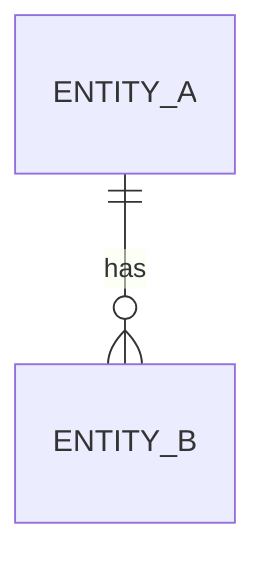

# 03 · Domain & Data

> **Authority:** Architecture. **AI policy:** WF-03 and WF-06 propose updates via PR.
> **Source-of-truth split:** database **migrations** are the technical truth for the *actual* schema. This document describes the *intended* domain model and what it means. When they disagree, that is drift: either fix the code or record a deviation.

## Ubiquitous language
<!-- The terminology check (blueprint check terminology) flags words from the Avoid column
     in the blueprint and in src/. Keep one term per concept. -->
| Term | Definition | Avoid |
|---|---|---|
| <Term> | <one-sentence meaning in this product> | <synonyms that must not be used> |

## Domain model
<!-- Entities, aggregates, relationships. Mermaid is rendered by GitHub. -->

## Entities
### <Entity>
- **Meaning:** <what it represents to the business>
- **Identity:** <natural / surrogate key>
- **Lifecycle:** <states and transitions>
- **Invariants:** <rules that must always hold>
- **Table(s):** `<schema.table>`

## Data ownership & access
<!-- Who may read/write which data. Row-level security policies should be traceable to this table. -->
| Data | Owner | Read | Write | Enforced by |
|---|---|---|---|---|
| <entity> | <role> | <roles> | <roles> | <RLS policy / service> |

## Data lifecycle & retention
- <retention, deletion, anonymisation rules>

## Migration conventions
- Location: `supabase/migrations/` (adjust in `governance/config.json` → `impactRules`)
- Every migration PR either updates this document, links a follow-up, or records a deviation (enforced by `check-impact`).
