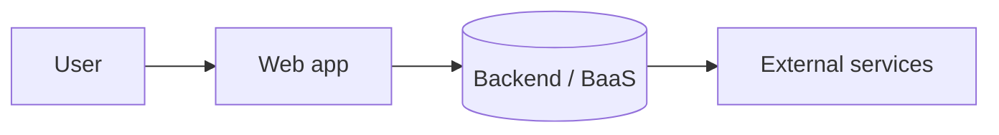

# 04 · Architecture & Technology

> **Authority:** Architecture. **AI policy:** agents propose updates via PR (`workflows/sync.md`, `workflows/review.md`). Significant decisions get an ADR in `blueprint/decisions/`.
> **Changes when:** structure, boundaries, technology or cross-cutting concerns change.

## System context

## Technology stack
| Layer | Choice | ADR |
|---|---|---|
| Frontend | <e.g. React + Vite + TypeScript + Tailwind + shadcn/ui> | <!-- ADR-0001 --> |
| Backend | <e.g. Supabase (Postgres, Auth, Edge Functions)> | |
| Hosting | <e.g. Lovable / Vercel> | |
| Testing | <e.g. Vitest, Playwright> | |

## Module structure & boundaries
<!-- Keep this table current: the review and audit workflows check imports against it.
     A tool such as dependency-cruiser can enforce it in CI if you want a hard check. -->
| Module | Path | May depend on | Must not depend on |
|---|---|---|---|
| UI components | `src/components/` | `src/lib/` | `src/integrations/` directly |
| Pages | `src/pages/` | components, hooks, lib | — |
| Data access | `src/integrations/` | — | `src/pages/`, `src/components/` |

## Cross-cutting concerns
- **Authentication & authorisation:** <approach; link 03 data access table>
- **Error handling & logging:** <approach>
- **Configuration & secrets:** <approach — never committed>
- **Performance budgets:** <budgets>

## Security baseline
- <e.g. RLS enabled on every table; service role only in server code; dependency scanning in CI>

## Architecture decision log
<!-- Index of ADRs. Status must match the ADR file. -->
| ADR | Title | Status |
|---|---|---|
